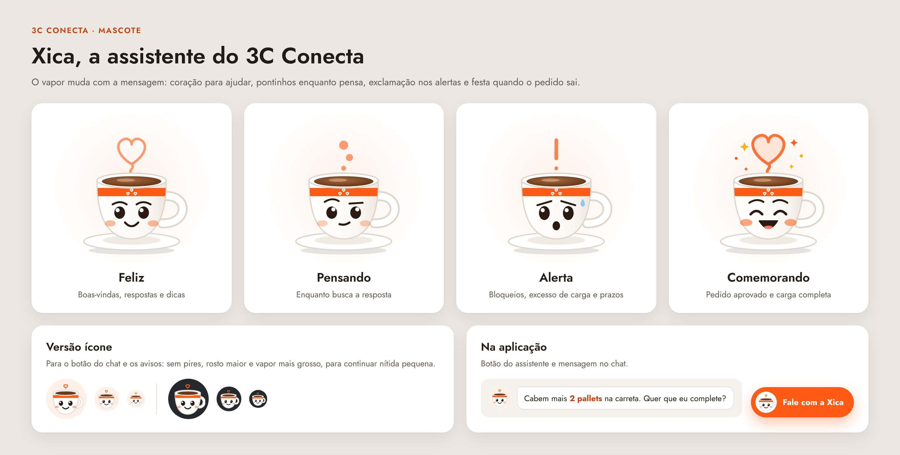

# Xica, a mascote do 3C Conecta

A Xica é a assistente da plataforma: uma xícara 3C cujo vapor muda com a mensagem. Ela aparece no chat, nos alertas e insights, na faixa Atenção agora, no pedido enviado e nas telas vazias, tanto na área do cliente quanto no painel da Exportação.

## Expressões

| Expressão | Vapor | Quando aparece |
|---|---|---|
| Feliz | coração | boas-vindas, respostas e dicas |
| Pensando | pontinhos | enquanto busca a resposta |
| Alerta | exclamação | bloqueios, excesso de carga e prazos |
| Comemorando | coração cheio e estrelinhas | pedido aprovado e carga completa |

## Arquivos

* `xica_feliz.svg`, `xica_pensando.svg`, `xica_alerta.svg`, `xica_comemorando.svg`: personagem completo, em vetor (use em telas grandes, slides e materiais impressos)
* `xica_icone_*.svg`: versão ícone, sem pires e com rosto maior, para o botão do chat, avatares e avisos (fica nítida até 28 px)
* `*.jpg`: prévias prontas para colar em apresentações e mensagens
* `xica_expressoes.jpg`: folha com as quatro expressões, a versão ícone e o uso na aplicação
* `xica_encerramento.jpg`: slide de encerramento do pitch (1920 × 1080 em alta resolução), com a frase "Exportar pode ser tão simples quanto um cafezinho."

Os SVGs foram exportados do próprio `index.html` (objeto `XICA`), então são idênticos ao que a plataforma desenha. Desenho original da equipe do 3C Conecta.

## Cores

* Laranja 3C Conecta: `#FE5C16`
* Café: `#6B3A1A`
* Contorno da xícara: `#DED5CB`
* Traço do rosto: `#2A1A12`
