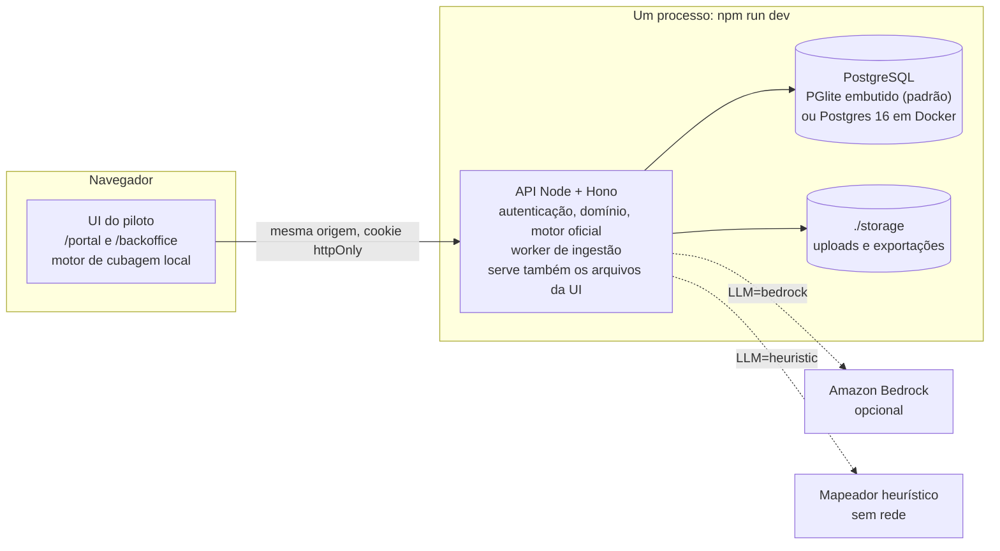
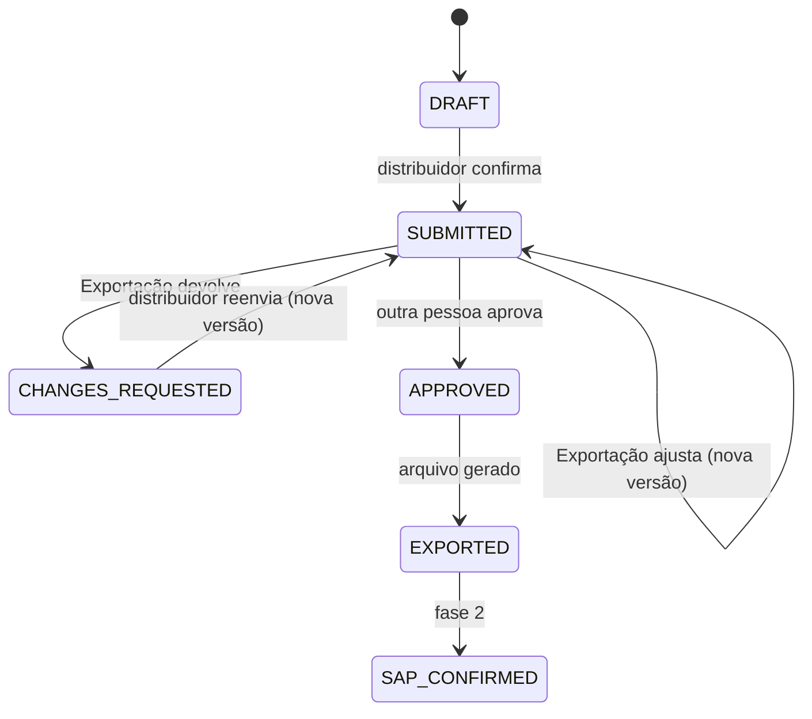
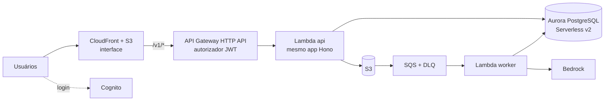

# Pedido sem Fronteiras — arquitetura da solução (v4)

Hackathon Cafeína Week 2026 · Desafio 02 · 3corações

Status: **aprovada pelo time em 13/10/2026**, com as correções da devolutiva da rodada 3 do juiz aplicadas (checklist em [`AVALIACAO_JUIZ.md`](AVALIACAO_JUIZ.md)). A nota registrada do juiz é 7,8; as correções não foram re-julgadas. Próximo passo: specs e plano de execução.

Base da análise:
- piloto 3C Conecta: repositório `orugian/3-coracoes-desafio-02`, branch `solucao-3c-conecta`, commit `636ac8d`. Depois da análise a branch avançou para `dca67be` (visão 3D, pedidos no `localStorage`, objeto `API` no navegador que espelha as rotas REST) e `f89cef4` (correções); o motor dá os mesmos resultados nos três commits (§2);
- planilhas do desafio (`pre-solucao/`) e arquivos `dados/*.json` (`container.json` de 13/10 às 15:52; `catalogo.json`, `produtos_internos.json` e `pedido.json` entre 16:24 e 16:26);
- decisões do time de 13/10 sobre preços (Q6), caixas por pallet (Q12) e uso de IA em nuvem (Q13), no §15;
- evidências detalhadas em [`ANEXO_EVIDENCIAS.md`](ANEXO_EVIDENCIAS.md);
- os números das seções 1 a 8 se reproduzem com `python docs/arquitetura/verificacao/verificar_numeros.py` (166 verificações, 152 sem o piloto; ver o que o script prova e o que não prova no Anexo G).

---

## 1. Resumo executivo

A pergunta-guia do desafio pede um pedido de exportação "simples, confiável e sem retrabalho". O piloto 3C Conecta já entrega a jornada no navegador: o distribuidor monta o pedido e vê pallets e ocupação do veículo, e a Exportação recebe o pedido validado. Falta o que o torna utilizável por duas partes diferentes: servidor, login com segregação de acesso, persistência e trilha de auditoria.

Proposta: **evoluir o piloto em vez de reescrevê-lo**.
1. O motor de cálculo do piloto é extraído para um módulo testado e passa a rodar no navegador (feedback imediato) e no servidor (resultado oficial).
2. Uma API em Node com PostgreSQL guarda pedidos, versões imutáveis e eventos, e aplica a segregação entre distribuidores e equipe 3corações.
3. O SAP é a fonte única dos dados mestres, com um portão de qualidade na importação.
4. A IA só lê planilhas fora do padrão e propõe o pedido; nunca calcula preço, peso ou pallet.
5. A fase 1 roda 100% local. A fase 2 sobe na AWS trocando adaptadores, sem reescrever regras.

Como a proposta responde às cinco dores do desafio:

| Etapa | Dor hoje | Resposta | Onde |
|---|---|---|---|
| 1. Monta | Planilha diferente a cada envio | Catálogo com preço da lista do cliente; upload de planilha que pré-preenche o pedido | §9 |
| 2. Valida | Conferência manual de múltiplos e restrições | Motor valida a cada digitação: múltiplo de caixa, lote mínimo, restrição por país | §8 |
| 3. Calcula a carga | Cubagem e pallets à mão | Posições, peso e cubagem ao vivo, com alerta de excesso, carga incompleta e sugestão de upsell | §8 |
| 4. Confirma | Cliente só sabe depois de alguém responder | Simulação confirmada, resumo do pedido, versões imutáveis | §7, §8 |
| 5. Recebe pronto | Redigitação e nenhum registro | Aprovação por uma segunda pessoa, arquivo de importação com escape, trilha de auditoria | §6, §10 |

Números que sustentam a proposta (todos conferidos nos arquivos fornecidos):

| Achado | Valor |
|---|---|
| Pedido-teste da Order Basis: o que ela mostra | 20.151,04 kg, 28,89 pallets, "OK" |
| O mesmo pedido com dados do SAP | 21.024,24 kg (+873 kg, +4,3%) e **30 posições de pallet** |
| Ocupação da carreta (28 posições, dado do artefato) | 107,1% das posições: **o pedido não cabe** |
| Erro de peso numa linha (filtro 12037417) | −41,9% |
| Divergências entre a Order Basis e o SAP | 20 (cadastro da caixa diferente em 6 de 10 SKUs) |
| SKUs sem preço no SAP | 3 de 10 |
| Login e chamadas ao servidor no piloto atual | Nenhum login e nenhuma chamada `fetch` (só o tema fica em `localStorage`) |

Ressalva que precisa estar visível no pitch: o veredito "não cabe" depende das posições de pallet por veículo (28, 20 e 10). Elas vêm do artefato e o time confirmou que estão corretas, mas **não constam em nenhum arquivo do desafio**: só com cubagem e peso (`container.json`) o mesmo pedido passa, com 81,8% de cubagem e 84,1% de peso. A tela mostra a premissa e a origem dela.

Decididas pelo time em 13/10: preço dos 3 SKUs sem registro no SAP (do site da 3corações, Q6), caixas por pallet de dois SKUs (heurística, Q12) e envio de planilhas de clientes a um modelo de IA em nuvem (autorizado, Q13). Ainda dependem de validação: layout oficial de importação do SAP (Q3), restrições reais por país (Q5), credencial do Bedrock (Q7), peso bruto do stick (Q9), dimensões dos veículos (Q10) e tara do pallet (Q14). Cada uma tem resposta padrão, e nenhuma trava as specs. Detalhes em §15.

### Para quem e o que muda: o pedido-teste, antes e depois

Os personagens são os do desafio. **Martín**, comprador de um distribuidor no Mercosul, diz: "só descubro como vai ficar meu pedido depois que alguém me responde". **Lucas**, analista de Exportação, diz: "cada pedido chega num formato diferente e, no fim, ainda digito tudo de novo no sistema".

| Momento | Hoje (Order Basis) | Com a solução |
|---|---|---|
| Martín monta o pedido | Planilha enviada por e-mail; não vê pallets nem ocupação | Vê, a cada digitação, posições, peso e cubagem do veículo, e o aviso "faltam 24 cx para fechar o pallet" |
| A validação | A planilha diz "OK" | O motor aponta **30 posições para 28** e propõe reduzir um item (o piloto já faz); trocar o veículo e dividir o embarque estão na especificação (§8, regra 6) |
| Lucas confere o peso | 20.151 kg, com uma linha 41,9% abaixo do real | 21.024 kg, do cadastro do SAP |
| Lucas lança no SAP | Digita item por item | Aprova (por uma segunda pessoa) e baixa o arquivo; a trilha mostra quem mudou o quê |

### O que a solução mede e o que ainda precisa de um ponto de partida

Os indicadores de sucesso do desafio são volume e receita de exportação, margem, países e canais ativos e nível de serviço. **Os arquivos fornecidos não trazem tempo de ciclo, volume de pedidos nem custo de frete** da operação atual, então este documento não afirma economia de horas ou de custo. O que ele afirma são os erros que os dados provam (§3). A plataforma passa a registrar, a cada pedido e como consequência da trilha de auditoria:

| Indicador | Como é medido | Ponto de partida |
|---|---|---|
| Tempo entre o envio e a aprovação | Eventos `SUBMITTED` e `APPROVED` | A medir na POC; hoje não é registrado |
| Pedidos aprovados sem ajuste | Pedidos com uma única versão | A medir na POC |
| Ocupação média dos embarques | Maior razão entre posições, peso e cubagem | A medir; o pedido-teste está em 107,1% |
| Linhas lidas sem intervenção | Ingestão de planilha | Meta de 95%; ainda não medida |
| Erros de peso evitados | Diferença entre o peso da OB e o do SAP | −4,3% no pedido-teste; −41,9% na linha do filtro |

---

## 2. O que o piloto já faz e o que falta

Verificado no commit `636ac8d`: executei o `calc()` do piloto em Node e comparei com o SAP (Anexo D). Nos commits `dca67be` e `f89cef4`, o mesmo harness dá os mesmos resultados. As mudanças desse commit que importam para a arquitetura: pedidos, carrinho e regras passam a ficar no `localStorage` (sobrevivem ao recarregamento, mas cada navegador tem a sua cópia, sem compartilhamento entre distribuidor e Exportação); um objeto `API` no navegador expõe os métodos `createOrder` (com chave de idempotência), `updateItem`, `approve`, `exportSap` e `setClientRule`, que viram o ponto de troca para chamadas ao servidor; e continua não havendo login nem `fetch` (Anexo D, P11).

| Capacidade | Piloto | Lacuna | Seção |
|---|---|---|---|
| Catálogo com fotos, preço da lista, PT/ES/EN, ficha técnica | Sim | — | — |
| Pedido em CX, UN ou KG, com aviso de caixa quebrada | Sim | — | — |
| Peso, cubagem, pallets, posições, ocupação e status da carga | Sim | Motor depende de variáveis globais da página | §8 |
| Sugestões: fechar pallet, completar o veículo, reduzir excesso | Parcial (uma sugestão por vez) | Várias opções, com valor | §8 |
| Painel da Exportação: fila, ajuste, aprovação, trilha | Sim, em memória | Trilha some ao recarregar | §7 |
| Exportação em CSV (layout SAP sugerido e padrão Order Basis) | Sim | Sem escape de aspas, `;` e fórmulas | §10 |
| Importação dos exports do SAP com prévia e alertas | Sim, no navegador | Roda no cliente, com SheetJS 0.18.5 | §10 |
| Login e segregação entre distribuidor e equipe | **Não** ("Demonstração sem senha") | Servidor e autenticação | §6 |
| Persistência | **Não** (recarregar zera tudo) | Banco | §7 |
| Dados sensíveis fora do navegador | **Não** (`CLIENTS` e `P[].ob` estão no HTML) | API | §6 |
| Restrição por país | Lista fixa de um cliente demo | Regra em dados | §8 |
| Leitura de planilha de pedido | Não | Ingestão | §9 |

---

## 3. O que os dados mostram

Resumo; cada item tem evidência e método no Anexo A–C.

| # | Achado | Impacto | Resposta |
|---|---|---|---|
| 1 | A OB valida só cubagem e peso (limite fixo de 25.000 kg). Não conta posições de pallet | Aprova pedido que não cabe | Motor valida as três restrições (§8) |
| 2 | A OB calcula o peso bruto da linha como peso da unidade × unidades por caixa, sem a embalagem. As unidades por caixa vêm de `peso líquido da caixa ÷ SUMIFS(peso líquido das linhas UN do mesmo material)`. O 12037417 aparece duas vezes na aba PROD (descrições "RED DES" e "DES AL"), então o `SUMIFS` soma 0,046 + 0,046 e o resultado cai de 40 para 20 unidades por caixa | No pedido-teste o peso bruto sai 4,3% **menor** que o do SAP (−873 kg); na linha do filtro, −41,9% | Peso sempre do registro CX do SAP (§7) |
| 3 | Cadastro da caixa diferente entre a OB e o SAP em 6 de 10 SKUs (medidas, volume ou peso) | Cubagem e peso incoerentes | SAP como fonte única (§7) |
| 4 | O próprio SAP tem registros implausíveis (lastro, altura, unidade de peso, volume) | Erro entra pela fonte "confiável" | Portão de qualidade com 10 regras e override com segunda pessoa (§7.3); caixas por pallet de 2 SKUs corrigidas por heurística (Q12) |
| 5 | 3 SKUs sem preço no SAP e 2 preços da OB diferentes do SAP (12142146: 50,01 contra 50,27; 12031189: 49,4067 contra 49,41) | Pedido sem preço ou com preço divergente | Preço do site da 3corações para os 3 SKUs (Q6) e origem do preço registrada (§7.2) |
| 6 | Lote mínimo buscado só por material: 12144012 herda o lote 3,12 da filial BHO e é marcado "NÃO" | Bloqueio indevido | Chave (material, centro) (§7) |
| 7 | Os `dados/*.json` v2 foram gerados a partir da OB. Herdam dela cx/pallet (2 SKUs) e volume (2 SKUs) e acrescentam um erro próprio: o peso líquido (4 SKUs) e o peso bruto (1 SKU) saem do **máximo entre todas as unidades de medida**, em valores crus. Das cx/pallet herdadas, o 98 do 12034109 é o valor adotado na Q12; o 60 do 20908885 não coincide nem com o SAP (110) nem com o adotado (77) | Quem consumir o JSON herda os erros (4 SKUs divergem do dado mestre adotado) | JSON passa a ser gerado do dado mestre: SAP mais overrides (§7.4) |
| 8 | Senha de cliente em texto puro na planilha e senha de macro no código | Governança | Autenticação real (§6) |

---

## 4. Decisão de arquitetura

| Critério | A. Evoluir o piloto (API + banco sob a UI atual) | B. Reescrever a interface em framework | C. AWS primeiro (serverless) |
|---|---|---|---|
| Reaproveita o que já foi validado | Sim: UI, motor, textos, fotos | Não | Parcial |
| Sempre existe uma demonstração funcionando | Sim, o piloto abre por `file://` | Não durante a reescrita | Não até o primeiro deploy |
| Segregação e integridade dos dados | Sim, no servidor | Sim | Sim |
| Dependências externas no caminho crítico | Nenhuma | Nenhuma | Conta AWS, modelo de IA, rede |
| Caminho para AWS | Troca de adaptadores | Troca de adaptadores | Já nasce lá |

Escolha: **A**. O critério decisivo é "sempre existe uma demonstração funcionando": nenhuma das outras opções garante isso durante a construção. Avaliação qualitativa; os critérios foram escolhidos pelo risco de execução, não por nota numérica.

---

## 5. Arquitetura da fase 1 (local)



Mesma origem (a API serve a UI): sem CORS e com cookie `httpOnly; SameSite=Strict`.

Cada recurso de infraestrutura fica atrás de uma interface. É isso que permite subir na AWS depois sem reescrever regras:

| Porta | Fase 1 (local) | Fase 2 (AWS) |
|---|---|---|
| `Db { query(sql, params); tx(fn) }` | PGlite (`db.transaction`) ou `pg` com Postgres 16 | Aurora PostgreSQL via `pg`, ou Data API (`BeginTransaction`) |
| `HttpRuntime` | `@hono/node-server` | `hono/aws-lambda` atrás do API Gateway |
| `FileStorage { createUploadUrl; read; write }` | `./storage`; upload por endpoint equivalente a URL pré-assinada | S3 com URLs pré-assinadas |
| `JobQueue` | tabela `ingestion_job` e worker sequencial | SQS (entrega pelo menos uma vez) + DLQ + Lambda |
| `IdentityProvider { login; verify }` | login próprio, `crypto.scrypt` e JWT | Cognito e `aws-jwt-verify`, com as mesmas claims |
| `LlmMapper` | `heuristic`, ou `bedrock` se houver credencial | `bedrock` |

No corte (§13), só a porta `Db` é uma interface no código (`server/src/ports/db.ts`, com os adaptadores PGlite e `pg`). As outras duas que o corte usa são módulos com fronteira definida, ainda sem interface própria:
- `HttpRuntime`: `createApp` não depende do runtime, e só `server/src/main.ts` chama o `@hono/node-server`.
- `IdentityProvider`: `server/src/auth/` emite e confere o JWT com as claims `sub` e `role` que o Cognito vai emitir.

As interfaces entram quando houver um segundo adaptador. `FileStorage`, `JobQueue` e `LlmMapper` são da F3. A árvore de pastas do §11 é a meta; o corte usa `server/src/{adapters/db,auth,portal,backoffice,orders,repo,domain,http}`.

Decisões e o porquê (a evidência dos achados está no Anexo F):
- **SQL puro, sem ORM.** Evita acoplamento entre ORM, driver `pg` e Data API. Os módulos só chamam `db.query` e `db.tx`.
- **Transação sempre por `tx(fn)`, nunca `BEGIN` solto.** O PGlite usa uma conexão única: no teste, duas requisições com `BEGIN`/`COMMIT` manual intercalados compartilharam a transação. Nenhuma transação fica aberta durante chamada ao modelo de IA ou leitura de planilha.
- **PGlite como banco padrão.** O daemon do Docker está desligado neste ambiente, e a banca pode rodar em máquina sem Docker. O mesmo esquema roda em Postgres 16 quando houver daemon.
- **Subconjunto de SQL comum aos alvos.** O PGlite é PostgreSQL 18; o Docker usará a 16; para o Aurora com Data API em São Paulo a documentação da AWS lista as versões 13.11, 14.8, 15.3, 16.1 e 17.4 ou superiores. Colunas geradas sempre `STORED` (no PG 18, sem a palavra-chave a coluna vira virtual, e em PG 16 isso é erro de sintaxe). O mesmo conjunto de migrações roda no PGlite e no Postgres 16 como teste.
- **Jobs idempotentes** por `ingestion_job.id`, porque o SQS pode entregar a mesma mensagem duas vezes.

---

## 6. Acesso e segregação

"Vendedores", no pedido original, são os compradores da 3corações, de outros países, que revendem o produto no país de destino (resposta do time à Q2). O modelo tem então dois públicos: usuários externos (distribuidor) e equipe 3corações.

| Papel | Quem | Escopo de dados |
|---|---|---|
| `ext_distribuidor` | Comprador ou vendedor do distribuidor | Só os clientes listados em `user_customer_scope` |
| `int_exportacao` | Analista ou gestor de Exportação | Todos os clientes |
| `int_admin` | Responsável por dados e usuários | Global |

Matriz de permissões (deny-by-default):

| Ação | `ext_distribuidor` | `int_exportacao` | `int_admin` |
|---|---|---|---|
| Ver catálogo com o preço da própria lista | Sim | Qualquer lista | Qualquer lista |
| Simular e confirmar pedido | Sim, do próprio cliente | Em nome de qualquer cliente | Não |
| Ver pedidos | Só os próprios | Todos | Todos (leitura) |
| Editar pedido (gera nova versão) | Só rascunho próprio e o reenvio do pedido devolvido | Sim | Não |
| Devolver ao distribuidor (pede ajuste, com motivo) | Não | Sim | Não |
| Aprovar | Não | Sim, desde que não tenha criado nem editado **nenhuma** versão do pedido | Não |
| Exportar para o SAP (fase futura, §13) | Não | Sim | Não |
| Ver origem do preço, divergências e dados mestres | Não | Leitura | Sim |
| Importar exports do SAP: prévia | Não | Sim | Sim |
| Importar exports do SAP: aplicar o lote (muda preços e dados mestres) | Não | Não | Sim |
| Liberar quarentena e fazer override de dado mestre | Não | Confirma o override proposto pelo administrador | Propõe, com justificativa; o override só vale depois da confirmação de um usuário `int_exportacao` |
| Regras comerciais do cliente: pallet misto e aprovação automática | Não | Sim, com registro | Sim, com registro |
| Usuários, parâmetros de veículo e regras de país | Não | Não | Sim |

A aprovação automática (já existente no piloto) é a única exceção à aprovação por segunda pessoa: vale só para o cliente em que uma pessoa identificada a ligou, só para pedido sem bloqueio e com carga completa, e o evento registra a regra e quem a ligou. Vem desligada no seed.

Controles:
1. `/v1/portal/*` aceita só `ext_*`; `/v1/backoffice/*` só `int_*`.
2. O escopo de cliente vem do banco, nunca do corpo nem da URL. Atende usuário com mais de um código de cliente.
3. **O que sai do HTML do piloto:** `CLIENTS` (listas, fatores, bloqueios), `P[].ob` (valores da Order Basis) e os preços de outras listas. O catálogo chega por `GET /portal/catalog`, já filtrado para o cliente do usuário. Regras do motor e parâmetros de veículo não são sigilosos e vão ao navegador.
4. O servidor **recalcula** o pedido ao confirmar e ao aprovar; o resultado do navegador é só pré-visualização.
5. Sessão: JWT de 8 h em cookie `httpOnly; SameSite=Strict`, com identificador de sessão e revogação no logout; limite de tentativas e bloqueio temporário no login.
6. Testes automatizados de isolamento: distribuidor A lendo pedido de B recebe 404; token externo em rota interna recebe 403; a resposta de `/portal/catalog` não contém campo interno.
7. Usuários do seed (sem auto-cadastro, senhas geradas e fora do git): 2 distribuidores (MINOIL e o cliente demo Río Claro, necessário ao teste de isolamento), 2 de Exportação (Lucas e uma colega: quem criou ou editou uma versão não aprova o pedido, e um deles confirma overrides do administrador) e 1 administrador.

---

## 7. Dados

### 7.1 Fonte autoritativa por campo

| Dado | Fonte | Observação |
|---|---|---|
| Medidas, volume, pesos líquido e bruto, unidades por caixa, EAN, DUN, validade | SAP, Conferência de produtos (linha da unidade CX; o EAN é o da UM de consumo e o DUN o da CX) | Pesos normalizados para kg. O override de peso fica em `master_override`, não numa coluna de origem |
| Caixas por pallet | SAP, Materiais (lastro × altura) | Lastro e altura guardados separados. 12034109 e 20908885 usam o valor adotado na Q12 (98 e 77), por `master_override` (§7.3) |
| Preço por caixa e vigência | SAP, Registros (lista, material, UM, datas) | Preço é sempre por **CX** |
| Preço dos 3 SKUs sem registro | Site da 3corações (informação do time, Q6): 36,96, 29,48 e 17,611, os mesmos da aba TAB da OB e dos JSON v2 | Origem `SITE_3C` |
| Lote mínimo em pallets | OB, aba PALETIZAÇÃO, por filial | A OB tem três filiais (BHO, LONT, NAT), mas os exports do SAP só trazem o centro 2612. O mapa filial→centro da tabela `branch_plant` só está definido para LONT→2612 (premissa); para as outras filiais não há dado. Sem linha da filial: padrão de 1 pallet |
| Descrições pt/es/en | OB, aba AUX | 2 SKUs sem es/en; o piloto tem textos próprios. No corte, o seed carrega os textos do piloto e confere contra a AUX (specs, D11) |
| NCM e linha | OB, aba PROD | No corte, carregados do piloto e conferidos (D11) |
| Cliente (código, lista, Incoterm, pagamento, moeda, idioma, filial) | OB, aba DADOS CLIENTES | Sem a senha |
| Cubagem e peso dos veículos | `dados/container.json` (igual à aba AUX) | — |
| Posições de pallet dos veículos | Artefato 3C Conecta, confirmado pelo time | Não consta nos arquivos do desafio |

### 7.2 Modelo

Todo registro mestre aponta para o lote de importação de origem (`import_batch`). Lotes nunca são apagados: um novo lote ativo substitui o anterior, e isso garante a reprodutibilidade.

| Tabela | Chave | Conteúdo |
|---|---|---|
| `import_batch` | `id` | Fonte, arquivo, hash, estado (staged, active, superseded, rejected), relatório de qualidade, autor. Único por (fonte, hash) |
| `customer`, `branch_plant` | código de exportação; filial | Cliente e mapa filial→centro. Só LONT→2612 está definido (premissa); BHO e NAT não têm centro nos dados |
| `material`, `material_i18n` | `material_code`; (material, idioma) | Descrições, família (da hierarquia SAP), marca, NCM |
| `material_uom` | (material, UM) | Fator, EAN, medidas, volume declarado, pesos, unidade de peso original |
| `palletization` | (material, centro) | Lastro, camadas, `boxes_per_pallet` (`STORED`), lote mínimo, fonte |
| `price` | `id` | Canal, centro, lista, cliente (nulo = lista), material, UM (CX), vigência, preços, moeda, `origin` |
| `vehicle_type` | `id_veiculo` | Modal, cubagem, carga útil, posições, `source_by_field` |
| `country_rule` | `id` | País, escopo e tipo `BLOCK`; marca `is_demo` |
| `app_user`, `user_customer_scope` | — | Usuário, papel e escopo de clientes |
| `order` | `id` | Cliente, estado, versão atual, veículo, modo de carga, pallet misto, controle otimista |
| `order_version` | (pedido, versão) | Linhas, resultado do motor, `engine_version`, lotes de dados usados, hash do conteúdo, autor, motivo. **Imutável** (trigger bloqueia UPDATE e DELETE) |
| `order_event` | `id` | Quem, quando, o quê, de qual estado para qual. Somente inserção |
| `ingestion_job`, `layout_template`, `customer_sku_alias` | — | Leituras por IA, layouts aprovados e apelidos de SKU |
| `sap_export` | — | Versão exportada, layout, arquivo, hash, autor |
| `master_override` | — | Override de dado mestre: quem, por quê, valor SAP e valor adotado |

Regras do preço (`origin`, mantido para rastreabilidade): `SAP_LIST` (registro vigente), `SITE_3C` (preço publicado no site da 3corações, para SKU sem registro no SAP; informação do time, Q6) e `DEMO_DERIVED` (lista AR do cliente demo, igual à lista US × 1,06). O distribuidor vê o preço `SITE_3C` como qualquer outro. No backoffice a linha leva o rótulo "fora da lista SAP · site 3corações"; não há reconhecimento obrigatório na aprovação, que só existia enquanto a origem do valor não estava esclarecida. Sem nenhum preço, a linha bloqueia o envio. Preço guardado com 2 casas decimais (o 17,611 do 20908885 é arredondado para 17,61 na entrada), e o total da linha é sempre `caixas × preço arredondado`, para que `VALOR_TOTAL = QTD × PRECO_UNIT` no arquivo do SAP.

Estados do pedido: `DRAFT → SUBMITTED → APPROVED → EXPORTED`; devolução `SUBMITTED → CHANGES_REQUESTED`, e o distribuidor reenvia uma nova versão (`CHANGES_REQUESTED → SUBMITTED`); na fase 2 acrescenta `SAP_CONFIRMED`. O rascunho (`DRAFT`) fica no navegador e não é gravado no servidor no corte. O envio do distribuidor é bloqueado por alerta de severidade `BLOCK`; as exceções declaradas são o pedido importado da OB (que entra com o bloqueio para a Exportação ajustar) e as versões criadas pela Exportação durante o ajuste. A aprovação sempre exige zero bloqueios. No corte atual (§13) o pedido termina em `APPROVED`: `EXPORTED` depende da exportação, adiada.



### 7.3 Portão de qualidade da importação

Severidade: `BLOCK` manda o registro para quarentena e ele não substitui o dado ativo até um `int_admin` liberar; `WARN` importa e alerta; `INFO` só registra. **A quarentena nunca remove do catálogo um SKU já ativo.**

| Código | Severidade | Regra | Dispara hoje em |
|---|---|---|---|
| `DUP_KEY` | BLOCK, a menos que a descrição do SAP desempate | Chave natural repetida | 12037417 na PALETIZAÇÃO: duas linhas ("DES AL", lote 1, e "RED DES", lote 2). A Conferência SAP usa "RED DES", então vale o lote 2 e o caso vira INFO |
| `UOM_G_TO_KG` | INFO | Peso em G convertido para kg | 12147801 |
| `GROSS_LT_NET` | WARN, com override | Bruto menor que líquido após normalizar | 12147801 (Q9) |
| `VOL_MISMATCH` | WARN | Volume declarado difere das medidas em mais de 2%. O `engine_version` 2 usa as medidas nos SKUs em desacordo; o `engine_version` 1 (piloto) usa o volume declarado | 12144012 (7,0%). 12147801 fica em 1,4% |
| `LAYER_FILL_OUT_OF_RANGE` | WARN | Área do lastro fora de 70% a 102% da base PBR | No export do SAP: 12034109 (28,4% com lastro 4). Com o override da Q12 (lastro 14, 99,3%) não dispara no dado ativo |
| `PALLET_TOO_TALL` | WARN | Camadas × altura + base de 0,15 m acima da menor altura interna entre os veículos | No export do SAP: 20908885 (2,65 m com 10 camadas). Com o override da Q12 (7 camadas, 1,90 m) não dispara no dado ativo. Altura é premissa (Q10) |
| `MISSING_PRICE` | WARN com preço `SITE_3C`; BLOCK sem nenhum preço | Material ativo sem registro de preço no SAP | 12034109, 12037417, 20908885 |
| `MIN_LOT_DEFAULTED` | WARN | Sem lote mínimo para o centro: usa 1 pallet | 12034103 (só existe a linha BHO) |
| `SOURCE_DIVERGENCE` | INFO | Valor da OB difere do SAP | As 20 divergências do piloto |
| `DERIVED_MISMATCH` | WARN | Valor de uma projeção (JSON) difere do dado mestre ativo (SAP mais overrides) | 4 SKUs nos JSON v2: 12142501, 12144012, 12147801 e 20908885 (Anexo B). O 12034109 diverge do SAP, mas não do valor adotado |

Prevalece o valor do SAP. Há três exceções, todas registradas em `master_override` com os dois valores visíveis e criadas pelo seed:
- **Peso bruto do stick 12147801:** o SAP traz um valor impossível (0,89 em gramas, menor que o líquido); o override usa 1,2 kg da OB, com a justificativa "SAP com unidade trocada; valor do piloto e escolha conservadora para o limite de peso" (Q9).
- **Caixas por pallet de 12034109 e 20908885** (Q12, heurística do time, não confirmada pela logística): 12034109 passa de 4 × 7 = 28 para **14 × 7 = 98**; 20908885 passa de 11 × 10 = 110 para **11 × 7 = 77**. Justificativa: "heurística do time (Q12)". A regra da heurística, para reaplicar em casos novos: (1) respeitar os limites rígidos, com lastro dentro do limite por área da base e altura do pallet, com base de 150 mm, até 2.393 mm; (2) preferir o valor sustentado por mais de uma fonte e que decomponha em lastro × camadas inteiros; (3) conferir o preenchimento da base contra a faixa dos demais SKUs (79,6% a 97,4%). No 12034109, as abas TAB e PALETIZAÇÃO da OB concordam em 98, o SAP concorda nas 7 camadas, e o lastro 4 cobriria 28,4% da base. No 20908885, a PALETIZAÇÃO dá 924 un ÷ 12 = 77, que decompõe em 11 × 7 com o lastro do SAP; as 10 camadas do SAP levariam o pallet a 2.650 mm, e o 60 da aba TAB não decompõe (5,45 camadas). O teste de empacotamento por guilhotina **não** serve de critério: dá no máximo 13 por camada no 12034109, mas também reprova o lastro 14 real do 12031189 (dá 12). Evidência no Anexo A (E11).

Um override de dado mestre exige papel `int_admin`, justificativa e a confirmação de um usuário `int_exportacao`; os do seed são criados com proposta e confirmação dos usuários do seed (§6, controle 7).

### 7.4 Contratos de leitura derivados dos JSON

Os dois arquivos viram contratos de API, e o recorte coincide com a segregação:
- `catalogo.json` → `GET /v1/portal/catalog` (visão externa). O motor roda no navegador, então o contrato precisa trazer **tudo o que o cálculo usa**: nome e descrições pt/es/en, família, preço da lista do cliente, unidades por caixa, medidas, volume, pesos líquido e bruto, lastro e camadas (caixas por pallet), lote mínimo do centro, EAN, DUN e NCM. Nada disso é sigiloso; o que não vai ao navegador é o preço de outras listas, a origem do preço e os alertas internos. O contrato **não** traz `caixas_pedidas` nem `valor_pedido`, que pertencem ao pedido, e **não** reproduz o formato do JSON v2, que perde campos e carrega os erros do Anexo B;
- `produtos_internos.json` → `GET /v1/backoffice/products` (visão interna: origem do preço, lote mínimo, alertas de qualidade);
- `pedido.json` → modelo do pedido importável no padrão OB e baseline para comparação.

As respostas são **geradas pelo importador a partir dos exports do SAP e dos overrides ativos**. Nenhum JSON é editado à mão. Os arquivos atuais entram no seed apenas como fonte dos dados que só existem na OB (descrições es/en, NCM, linha, lote mínimo e cliente).

---

## 8. Motor de cubagem e validação logística

Módulo puro (`packages/engine`, fonte em ESM; o build gera também um script clássico para a UI), sem I/O e versionado. É o `calc()` do piloto refatorado: hoje ele lê variáveis globais (`P`, `VEH`, `CLIENTS`, `S`); passa a receber catálogo, cliente, veículo, modo e linhas. Roda no navegador e na API.

Parâmetros:

| Veículo (`id_veiculo`) | Modal | Cubagem | Carga útil | Posições |
|---|---|---|---|---|
| `carreta_padrao` | rodoviário | 72 m³ | 25.000 kg | 28 |
| `container_40` | marítimo | 60,84 m³ | 25.000 kg | 20 |
| `container_20` | marítimo | 29,7 m³ | 25.000 kg | 10 |

Cubagem e carga útil vêm de `container.json`, que confere com a aba AUX da OB. As posições vêm do artefato, com pallet PBR de 1,20 × 1,00 m, e o time confirmou que estão corretas (Q4). Status da carga (regra do piloto): acima de 100%, excesso; a partir de 90%, completa; abaixo de 90%, incompleta.

Regras:
1. **Unidade:** UN e KG são convertidos para caixas (UN pelas unidades por caixa; KG pelo peso líquido da caixa). Quantidade quebrada bloqueia até o cliente escolher o arredondamento. Exemplo do piloto: 1010 UN do 12031291, com 20 un/cx, são 50,5 caixas.
2. **Linha:** peso e volume do registro CX; valor = caixas × preço vigente. Item sem preço entra nos totais físicos e fica fora do valor.
3. **Paletizada:** caixas por pallet = lastro × camadas. Sem pallet misto, cada pallet incompleto ocupa uma posição. Com pallet misto, posições = ⌈soma dos pallets⌉ (regra do piloto; é otimista porque ignora altura). Lote mínimo por (material, centro).
4. **Estivada (P0):** sem pallet, as caixas vão direto no piso do veículo. O deck diz que "a alocação segue as medidas da planilha Materiais", mas essa planilha só traz lastro e altura (caixas por camada e número de camadas), sem milímetros. A leitura adotada é que a Materiais define o **padrão de empilhamento** (pilhas de até `altura` camadas), e a caixa ocupa no piso a área C × L da Conferência. O motor calcula: pilhas = ⌈caixas ÷ altura⌉ e área de piso = pilhas × C × L. Compara essa área com o piso do veículo e mantém os testes de peso e cubagem do piloto; a restrição dominante pode ser qualquer um dos três.
   - O **piso do veículo não consta em nenhum arquivo**. A premissa é piso = posições × 1,2 m² (o pallet PBR de 1,20 × 1,00 m): carreta 33,6 m², contêiner 40' 24,0 m², contêiner 20' 12,0 m². É a mesma premissa que já sustenta as posições de pallet, e o resultado aparece rotulado como **estimativa**, nunca como veredito (Q10). Em vez de o texto anterior ("falta a dimensão interna, então fica de fora"), a decisão agora é calcular com a premissa visível, que é o mesmo critério usado para as posições.
   - No pedido-teste estivado, a área de piso é 32,43 m²: 96,5% do piso da carreta pela premissa de 33,6 m². O modelo só de peso e cubagem (84,1% e 81,8%, "incompleta") subestima a ocupação. No contêiner 40' a premissa dá 135,1% do piso, contra 96,8% da cubagem.
5. **Veículo:** ocupação = o maior entre posições, peso e cubagem; informa qual é o recurso limitante.
6. **Upsell:** (a) caixas que faltam para fechar o pallet; (b) com posições livres, até três combinações de pallets cheios que cabem no peso, na cubagem e no lote mínimo, priorizando itens já no pedido e depois o maior valor por posição; (c) em excesso, reduzir um item, trocar de veículo ou dividir em dois embarques.
7. **País:** `country_rule` do país do cliente gera `COUNTRY_RESTRICTED`, que bloqueia o envio. Na fase 1 só existe o tipo `BLOCK`, com a regra do piloto (porta filtro bloqueado para o cliente demo).

Alertas do motor (código estável, severidade e texto localizado): `QTY_NOT_MULTIPLE` (BLOCK), `BELOW_MIN_LOT` (BLOCK), `NO_PRICE` (BLOCK), `COUNTRY_RESTRICTED` (BLOCK), `VEHICLE_EXCEEDED` (BLOCK), `PALLET_INCOMPLETE` (WARN), `VEHICLE_UNDERFILLED` (WARN). O preço `SITE_3C` não gera alerta: só o rótulo no backoffice (§7.2).

Versões do motor: o `engine_version` 1 reproduz o piloto (sem tara, volume declarado). O `engine_version` 2 acrescenta a tara do pallet, de 25 kg (premissa, Q14), e usa as medidas da caixa nos SKUs com `VOL_MISMATCH`. O resultado gravado em cada versão do pedido carrega a versão do motor que o gerou.

### Casos de teste de referência (golden tests)

Os casos 1 a 4 reproduzem números que o piloto também calcula: o script de verificação os recalcula em Python e, quando recebe o `index.html` do piloto, executa o `calc()` dele (`motor_piloto_harness.js`) e compara. O caso 5 é novo e depende de uma premissa de piso. Os casos 3 e 4 usam SKUs afetados pela Q12 e por isso têm duas variantes: a **do piloto** (dados embutidos no HTML, 28 e 110 cx/pallet), que serve para o confronto com o `calc()` original, e a **adotada** (dado mestre com os overrides do §7.3, 98 e 77 cx/pallet), que é o resultado esperado do motor novo. A diferença está nos dados, não na versão do motor.

**Caso 1 — pedido-teste da Order Basis** (carreta, paletizada; 3528 cx de 12031189, 300 de 12034103, 250 de 12037417, 300 de 12144012):

| Grandeza | Order Basis | Motor |
|---|---|---|
| Peso bruto das caixas | 20.151,04 kg | 21.024,24 kg |
| Peso bruto com tara (`engine_version` 2) | — | 21.774,24 kg (87,1% de 25.000) |
| Peso líquido | 19.070 kg | 19.230 kg |
| Cubagem | 58,88 m³ | `engine_version` 1: 58,88 m³ (81,8% de 72; 96,8% do contêiner 40'). `engine_version` 2, com as medidas: 59,04 m³ (82,0% e 97,0%) |
| Pallets | 28,89 (soma de frações) | **30 posições** |
| Ocupação da carreta | "OK" | **107,1% das posições: EXCEDIDA** (peso 84,1%, cubagem 81,8%) |
| Com 26 posições (dica de `AA2`) | — | 115,4% |
| Com pallet misto | — | 29 posições (103,6%), ainda excedida |
| Contêiner 40' | — | 150% das posições; 96,8% da cubagem |
| Valor | US$ 192.005,84 | US$ 192.017,48. A diferença de US$ 11,64 vem do preço do 12031189 (a OB usa 49,4067; o SAP, 49,41) |
| Lote mínimo de 12144012 | "NÃO" | Atendido (1,44 pallet, lote 1 em LONT) |
| Lote mínimo de 12034103 | — | `MIN_LOT_DEFAULTED` (só há linha BHO); 3,70 pallets, atendido |
| Para fechar o próximo pallet | — | faltam 24 cx (12034103), 23 cx (12037417) e 118 cx (12144012) |
| Só com cubagem e peso (`container.json`) | OK | OK. O motor testa também esta saída |

**Caso 2 — upsell** (carreta; 2352 cx de 12031189 e 1400 cx de 12142501): 19 posições (67,9%), 14.468,16 kg, valor US$ 146.396,32. Sobram 9 posições, 10.531,84 kg e 30,896 m³. Nove pallets cheios de qualquer SKU cabem no peso (o mais pesado tem 895,44 kg por pallet) e na cubagem (com os valores adotados, o mais volumoso tem 2,230 m³ por pallet; o 20908885 a 110 cx daria 2,788 m³, que também caberia), e nenhum viola o lote mínimo. Pela regra de prioridade (itens já no pedido primeiro, depois maior valor por posição), as três opções são: (1) 9 pallets de 12031189, US$ 74.707,92, 28 de 28 posições e 90,1% do peso; (2) 9 pallets de 12142501, US$ 54.331,20, 28 de 28 e 71,8% do peso; (3) 9 pallets de 12031291, o de maior valor fora do pedido, US$ 90.977,04, 28 de 28 e 90,1% do peso. As combinações mistas ficam para a fase de specs.

**Caso 3 — pedido aprovado do piloto** (cliente demo Río Claro, contêiner 40', lista AR; 1176 cx de 12031291, 140 de 12034109, 1400 de 12142501, 540 de 12147801). Nas duas variantes: 54,5% da cubagem, 38,9% do peso, 9.712,86 kg e valor US$ 123.761,08; com o stick a 0,89 kg em vez de 1,2 kg, o peso cai para 9.545,46 kg.

| Variante | 12034109 | Posições | Status |
|---|---|---|---|
| Piloto (28 cx/pallet, lastro 4 do SAP) | 5 pallets cheios | 20 de 20 (100%) | Completa |
| Adotada (98 cx/pallet, Q12) | 1,43 pallet: faltam 56 cx para fechar o segundo | 17 de 20 (85%) | Incompleta |

Na variante adotada, as 3 posições livres viram o exemplo de upsell num contêiner: fechar o pallet do 12034109 e ofertar pallets cheios pela regra 6.

**Caso 4 — restrição de país** (cliente demo; 110 cx de 20908885 e 560 cx de 12142501): `COUNTRY_RESTRICTED` no porta filtro e `BELOW_MIN_LOT` no 12142501 (2 pallets para lote 5), nas duas variantes. Na adotada, as 110 cx do 20908885 são 1,43 pallet (2 posições; faltam 44 cx para fechar o segundo); no piloto, com 110 cx/pallet, são 1,00. O lote mínimo vale na paletizada e na estivada, como no piloto.

**Caso 5 — pedido-teste estivado** (mesmo pedido do caso 1, sem pallets): o piloto, que só testa peso e cubagem, classifica a carreta como "incompleta" (84,1% de peso) e o contêiner 40' como "completa" (96,8% de cubagem). O modelo de piso do motor dá 32,43 m²: 96,5% do piso da carreta e 135,1% do contêiner 40', pela premissa de piso do §8. Resultado rotulado como estimativa.

---

## 9. Ingestão e IA

O distribuidor sobe a planilha dele e o sistema **pré-preenche o pedido**, que segue pelo mesmo motor e pela mesma revisão. A IA só interpreta a estrutura da planilha.

```
upload → storage → ingestion_job(queued) → worker
  1. leitura em grade (somente .xlsx e .csv)
  2. layout já aprovado para o cliente, ou o padrão Order Basis? → mapeamento direto, sem IA
  3. senão LlmMapper: bedrock (saída com schema JSON obrigatório, amostra de ~40 linhas) ou heuristic (dicionário pt/es/en)
  4. o mapa é aplicado de forma determinística a todas as linhas
  5. reconhecimento do SKU em cascata: código 3C → EAN/DUN → apelido do cliente
     → similaridade com as descrições pt/es/en, sem acento → o modelo escolhe entre os 5 melhores candidatos
  6. o motor valida; rascunho com a célula de origem de cada linha → revisão humana
  7. a aprovação grava o layout e os apelidos: a mesma planilha não passa de novo pela IA
```

Limites medidos e guardrails:
- A similaridade por trigramas é só um sugestor. "café tradicional vacio 250g 20 un" contra a descrição SAP abreviada dá 0,31; contra a descrição em espanhol da OB, 0,63. Por isso a cascata compara primeiro com as descrições es/en. Um limiar de aceite automático só será fixado depois de medir nas planilhas sintéticas.
- A IA não define preço, peso, pallet nem aprovação. A saída passa por validação de schema; o conteúdo da planilha é tratado como dado, sem ferramentas com efeito colateral.
- **Leitor de planilhas no servidor:** o SheetJS 0.18.5 do piloto tem duas vulnerabilidades conhecidas (CVE-2023-30533, prototype pollution, e CVE-2024-22363, ReDoS). No navegador, lendo o próprio arquivo do usuário, o risco é baixo; no servidor, lendo arquivo de terceiros, não. Usar SheetJS 0.20.2 ou superior (obtido do `cdn.sheetjs.com`, porque o pacote do npm parou em 0.18.5) ou ExcelJS 4.4.0 (não auditei as dependências dele); parse em `worker_threads` com limite de memória e tempo; até 10 MB; rejeitar `.xlsm` e `.xls`.
- O seed é uma CLI confiável, separada do upload: ela lê a OB (`.xlsm`) para lote mínimo, descrições e divergências.
- Modelo: Claude Haiku 4.5 como padrão, com ID configurável. **O Sonnet 4.5 não serve de reforço:** está em status Legacy (fim de vida em 08/04/2027) e, segundo a documentação do Bedrock, clientes novos não podem adotar um modelo Legacy e os existentes podem perder o acesso após 15 dias de inatividade. O reforço deve ser um modelo Active, a escolher na conta disponível (Q7). O Haiku 4.5 está Active, mas a garantia de disponibilidade da AWS vale até 16/10/2026 no mínimo (a data de fim de vida ainda não foi definida), então o ID do modelo é configuração, nunca código.
- Em São Paulo, esses modelos só estão disponíveis em **inferência global** (In-Region e Geo: não). Uma chamada pode ser processada fora do Brasil. O conteúdo é comercial (SKU e quantidade) e não contém dado pessoal, e o time autorizou o envio de planilhas de clientes a um modelo em nuvem com inferência global (Q13). O que segue valendo: só a amostra necessária ao mapeamento vai ao modelo (~40 linhas).
- Avaliação: 3 planilhas sintéticas (cabeçalho em espanhol; EAN no lugar do código; quantidade em UN com células mescladas). Meta de ≥ 95% das linhas reconhecidas e nenhum erro silencioso; é meta, ainda não foi medida. Sem credencial do Bedrock, vale o mapeador heurístico e a meta é medida só nele.

---

## 10. Integração com o SAP

| Sentido | Fase 1 (local) | POC |
|---|---|---|
| SAP → plataforma | O importador do piloto passa ao servidor: assinatura de cabeçalho, prévia (novos, alterados, alertas), quarentena e ativação atômica do lote. O seed usa os arquivos reais de `pre-solucao/` | Extração agendada via OData ou RFC |
| Plataforma → SAP | CSV no layout do piloto, com aspas, escape e neutralização de fórmulas. Também o pedido completo no padrão Order Basis. Arquivo e hash em `sap_export` | Criação direta da ordem via API ou BAPI |

Layout do piloto: `PEDIDO_PORTAL;COD_CLIENTE;REF_CLIENTE;CANAL;CENTRO;LISTA_PRECO;MATERIAL;DESCRICAO_SAP;QTD;UM;PRECO_UNIT;MOEDA;VALOR_TOTAL;INCOTERM;COND_PAGTO;DATA_CARREGAMENTO`. O material do desafio não traz o layout oficial de importação (Q3) e o VBA da OB só salva em PDF ou Excel; o layout continua declarado como premissa.

O CSV atual do piloto concatena campos sem aspas: um `;` ou quebra de linha na referência do cliente desloca colunas, e um texto começando com `=`, `+`, `-` ou `@` vira fórmula ao abrir no Excel.

---

## 11. Frentes e contratos

O requisito é a integração fácil entre front-end, back-end e nuvem. Ela vem de **contratos escritos primeiro** e de um motor com testes que serve de ponto de encontro.

```
repo/
  index.html, vendor/, assets/   UI do piloto em JS clássico, sem framework nem build, na raiz como hoje (o front trabalha nesses caminhos)
  demo-data.js, api-client.js    dados do modo demo (o servidor não serve) e cliente da API (specs 05)
  server/              Hono: domain/ ports/ adapters/{local,aws}/ routes/
  packages/contracts   schemas zod: requisições, respostas, alertas, enums
  packages/engine      motor + golden tests
  db/migrations        SQL puro
  db/seed              extrator, decisões do time e fontes geradas
  infra/aws            CDK (fase 2)
  data/ingest-samples  planilhas sintéticas (F3)
```

| Frente | Entrega | Depende de | Entrega a quem, por qual contrato | Responsável |
|---|---|---|---|---|
| Dados | Projeções `dados/*.json` (catálogo, produtos internos, pedido-teste, veículos) | Planilhas | Seed e conferência, via `dados/` | Cecília Fabre (concluído) |
| Motor | `packages/engine` extraído do `calc()`, golden tests, build para a UI | Seed | Front e back, via `engine` | Guilherme Orugian; Bruno Rosa revisa a paridade |
| Back-end | Esquema, seed, API, autenticação e segregação, pedidos com versões, backoffice | `engine`, seed | Front, via `contracts` (OpenAPI gerado do zod) | Guilherme Orugian |
| Integração web | Cliente da API e boot da UI em modo servidor, mantendo o modo `file://` | `contracts` | Front-end | Guilherme Orugian, com Ruan e Bruno |
| Front-end | Portal e backoffice sobre a UI do piloto: login, estados de carregamento e erro | Cliente da API | Usuário final | Ruan Ruales e Bruno Rosa |
| IA | Ingestão de planilhas | API, `engine`, catálogo | Back-end, pelo `LlmMapper` | Guilherme Orugian (fora do corte atual, §13) |
| Nuvem e infraestrutura | Scripts locais e, depois da validação local, CDK | Portas do §5 | Todas, pelos adaptadores | Guilherme Orugian |

Equipe (4 devs, decisão do time em 13/10): Cecília tratou os dados e os entregou nos JSON; Ruan Ruales (o "Juan" das conversas) e Bruno Rosa fazem o front-end; Guilherme Orugian faz tudo o que é back-end, a integração e a nuvem. O pitch ainda não tem responsável.

Contratos principais: catálogo do portal (com todos os campos que o motor usa, §7.4), rascunho de pedido, resultado do motor (totais, linhas, alertas, sugestões, `engine_version`), relatório de importação, linha do arquivo SAP. O detalhamento campo a campo está nas specs (`docs/specs/`).

Superfície da API (resumo; a do corte, com contratos e erros, está em `docs/specs/04-api.md`):
- Sessão: `POST /auth/login`, `POST /auth/logout`, `GET /auth/me`.
- Portal: `GET /portal/catalog`, `POST /portal/quote`, `POST /portal/orders`, `GET /portal/orders[/:id]`, `POST /portal/orders/:id/versions` (reenvio), `POST /portal/ingestions` (F3).
- Backoffice: `GET /backoffice/orders[/:id]`, `POST /backoffice/orders/:id/{versions,approve,return,export}` (`export` na fase futura), `GET /backoffice/customers`, `PUT /backoffice/customers/:code/rules`, `GET /backoffice/products`, `POST /backoffice/imports` (+ `/:id/apply`, `/:id/reject`; F3), `GET /backoffice/kpis`.

Migração do piloto, em passos em que ele continua utilizável:
1. Marcar o commit `f89cef4` (último do front antes da integração) como `demo-standalone`: é a contingência e abre por `file://`. A versão com servidor roda em `http://localhost`; os dois modos coexistem no mesmo `index.html`.
2. Extrair o motor e os dados para `packages/engine`, com os golden tests. O motor também é empacotado como script clássico para a UI continuar sem build.
3. Servidor e banco: migrações, importador com portão de qualidade e seed com os exports reais.
4. Autenticação e segregação. Para não reescrever as telas, o boot da UI busca o catálogo e a sessão (`/auth/me`) e preenche as mesmas variáveis que o piloto já lê (`P`, `BY`, `CLIENTS`), mantendo a renderização síncrona. Os dados sensíveis saem do HTML para `demo-data.js`, que o servidor não serve.
5. Pedidos persistentes: `POST /orders` recalcula no servidor e grava versão e evento.
6. Backoffice: fila, ajuste, aprovação por outra pessoa e exportação com escape.
7. Ingestão por planilha.
8. Fase 2 na AWS.

---

## 12. Segurança e observabilidade

| Tema | Fase 1 (local) | Fase 2 e POC |
|---|---|---|
| Autenticação | Sessão do §6; limite de tentativas; `crypto.scrypt` | Cognito, MFA para `int_*` |
| Autorização | Matriz papel × ação, escopo vindo do banco, testes de isolamento | + RLS no PostgreSQL |
| Arquivos | ≤ 10 MB, .xlsx e .csv, nome aleatório, fora do diretório web | S3 privado; GuardDuty Malware Protection |
| Exportação | CSV com escape e neutralização de fórmulas | Igual |
| Segredos | `.env` fora do git; `.env.example` sem valores | Secrets Manager |
| Dependências | Versões fixas; sem CDN em tempo de execução (o piloto tem um fallback para cdnjs sem verificação de integridade) | + varredura no CI |
| Auditoria | `order_version` imutável, `order_event`, `import_batch`, `ingestion_job`, `master_override` | + CloudTrail |
| Indicadores | SQL sobre eventos: tempo do envio à aprovação, ciclos de revisão, ocupação média, % de linhas reconhecidas, % exportado sem edição | CloudWatch |

A fase 1 é ambiente de desenvolvimento e não é exposta à internet.

---

## 13. Roadmap por fatias

Equipe de 4 devs (§11) e prazo do desafio no Dia 2, até 16:30. Cada fatia termina em algo verificável, e o piloto garante uma demonstração a qualquer momento.

**Corte de escopo (decisão do time, 13/10):** entram a segregação de acesso, os pedidos persistentes e o backoffice, ou seja, F0 a F2 sem a exportação. A **exportação para o SAP e para o padrão OB fica para uma fase futura**, depois que a arquitetura for validada na prática: na versão com servidor, o pedido termina em `APPROVED`, e o estado `EXPORTED`, a tabela `sap_export` e o §10 continuam como desenho. Também ficam fora do corte o importador do SAP por upload com quarentena e a ingestão por IA (F3), a nuvem (F4, depois da validação local) e o `engine_version` 2 (tara, medidas nos SKUs com `VOL_MISMATCH`, estivada por piso e upsell com três opções; o caso 5 só passa a valer com ele). O modo `file://` do piloto continua com todas as funções que já tem, inclusive o CSV. Dentro do corte, quatro pontos do §6 e do §11 ficam reduzidos (specs 01 e 04):
- a Exportação não envia pedido em nome do cliente; só ajusta, devolve e aprova;
- o administrador só lê pedidos, produtos e clientes, e altera as regras do cliente. Dado mestre, override, usuário e veículo só mudam pelo seed;
- o seed com as conferências do 03 ocupa o lugar do importador com portão de qualidade do passo 3 do §11;
- o navegador continua com o `calc()` do HTML como prévia, guardado pelo teste de paridade. O motor empacotado como script clássico (passo 2 do §11) fica para depois do corte.

Specs e plano por responsável ficam em `docs/specs/` e `docs/plano/`.

| Fatia | Conteúdo | Pronto quando | No corte |
|---|---|---|---|
| F0 | Motor extraído com os golden tests; migrações; seed a partir dos exports do SAP, do piloto e dos JSON; login com 5 usuários | Os casos 1 a 4 do §8 passam; login A e B funcionam; o seed roda sem Docker | Sim |
| F1 | Segregação real, pedidos persistentes e regra de país; upsell com três opções e estivada por piso | Testes de isolamento verdes; o pedido-teste mostra EXCEDIDA; recarregar não perde o pedido; o caso 5 passa | Sim, sem upsell de três opções e sem estivada por piso (`engine_version` 2) |
| F2 | Backoffice: versões, aprovação por outra conta, exportação com escape | Histórico de eventos completo; CSV exportado | Sim, sem a exportação |
| F3 | Importador por upload com o portão de qualidade e quarentena; ingestão de planilha | Relatório com as regras do §7.3; 3 planilhas sintéticas viram rascunhos | Não |
| F4 | Fase 2 na AWS | `cdk deploy` reproduz o ambiente | Depois da validação local |
| F5 | Pitch | Roteiro de 5 minutos | Responsável a definir |

Momentos que tornam o servidor visível na demonstração: login como distribuidor A e tentativa de abrir o pedido do B (404); histórico de versões de um pedido; quarentena da importação do SAP; premissa de posições de pallet visível e editável.

### Roteiro do pitch (F5, 5 minutos)

Cada bloco indica a fatia de que depende; se ela não entrar no corte, o bloco usa o piloto (`demo-standalone`) e a fatia vira próximo passo.

| Tempo | O que mostrar | Mensagem | Depende de |
|---|---|---|---|
| 0:00–0:40 | Martín e Lucas; a planilha da OB dizendo "OK" | O pedido de exportação chega em formatos diferentes e é redigitado | — |
| 0:40–1:40 | Pedido-teste: OB com 28,89 pallets e 20.151 kg; motor com 30 posições para 28 (107,1%) e 21.024 kg; filtro a −41,9% | A planilha aprova um pedido que não cabe. **Ressalva dita em voz alta:** as posições (28, 20, 10) vêm do artefato e foram confirmadas pelo time, mas não estão nos arquivos do desafio; só com cubagem e peso o pedido passa (81,8% e 84,1%) | Piloto ou F0 |
| 1:40–2:50 | Portal: login de distribuidor, catálogo com o preço da lista dele, "faltam 24 cx", EXCEDIDA e as três sugestões; tentativa de abrir o pedido de outro distribuidor (404) | O cliente sabe na hora como fica o pedido, e só vê o que é dele | F0 e F1 |
| 2:50–3:50 | Backoffice: fila, ajuste de Lucas gerando nova versão, aprovação recusada para ele e feita pela colega, histórico de versões | Lucas recebe pronto e há registro de quem mudou o quê | F2. O CSV para o SAP só aparece no modo `file://`, como próxima fase |
| 3:50–4:30 | Planilha em espanhol virando rascunho de pedido | A IA lê a planilha; preço, peso e pallet continuam com o motor | F3 (fora do corte: mostrar a importação determinística do piloto e apresentar a IA como próximo passo) |
| 4:30–5:00 | Indicadores que passam a ser medidos; fase 2 na AWS; perguntas em aberto | Não prometemos economia de horas ou de custo: os dados do desafio não trazem esse ponto de partida | — |

---

## 14. Fase 2 na AWS



O que não muda: domínio, motor, migrações, importadores e contratos. O que muda: os adaptadores do §5 e uma stack de infraestrutura como código.

Fatos verificados na documentação da AWS:
- O Data API do Aurora PostgreSQL é suportado em São Paulo, nas versões 13.11, 14.8, 15.3, 16.1 e 17.4 ou superiores.
- Em São Paulo, Claude Haiku 4.5 e Sonnet 4.5 só funcionam por inferência global.
- Haiku 4.5: status Active. Sonnet 4.5: status Legacy, fim de vida em 08/04/2027; modelos Legacy não podem ser adotados por clientes novos, e clientes existentes podem perder o acesso após 15 dias de inatividade.

Pontos de atenção:
- Upload de 10 MB não passa por Lambda síncrono (limite de 6 MB); por isso o upload já nasce por URL pré-assinada na fase 1.
- Com cookie `SameSite=Strict`, o CloudFront precisa rotear `/v1/*` ao API Gateway para manter a mesma origem.
- O login com Cognito muda o fluxo da tela, não só o verificador do token.
- O Data API converte tipos (`jsonb`, `daterange`), limita a resposta a 1 MiB (a chamada é encerrada se passar disso), só executa na instância de escrita e não funciona em classes de instância T. Um teste de integração antecede a migração.
- Tempos do Data API: uma transação é desfeita se ficar 3 minutos sem chamadas e dura no máximo 1 hora; cada chamada é cancelada aos 45 s, a menos que use `continueAfterTimeout`; a AWS recomenda timeout do SDK de pelo menos 1 minuto, para não repetir uma escrita que concluiu. A regra do §5 (nenhuma transação aberta durante chamada ao modelo ou leitura de planilha) já mantém as transações curtas; migrações longas rodam por conexão `pg`, fora do Data API.
- Extensões: `pg_trgm` e `btree_gist` (1.6) constam da lista de extensões do Aurora PostgreSQL em todas as versões 16, 17 e 18 publicadas (16.1 a 16.15, 17.4 a 17.11, 18.3 a 18.6). Verificado na documentação; não testei num cluster.
- Entrar nesta fase só com F0 a F3 concluídas.

---

## 15. Decisões tomadas e perguntas em aberto

Resolvidas:

| # | Pergunta | Resposta e efeito |
|---|---|---|
| Q1 | O repositório é o artefato? | Sim, é idêntico. Usado como referência |
| Q2 | Quem são os "vendedores"? | Compradores da 3corações, de outros países, que revendem o produto no país de destino. Dois públicos (externo e equipe); sem papel comercial interno |
| Q4 | Posições de pallet por veículo | 28, 20 e 10, dado do artefato, confirmado. Dimensões internas e altura **não** existem no artefato (ver Q10) |
| Q6 | Preço dos 3 SKUs sem registro no SAP | Vêm do site da 3corações (informação do time em 13/10; não conferi no site): 36,96 (12034109), 29,48 (12037417) e 17,611 (20908885), os valores dos JSON v2. Origem `SITE_3C`, rótulo no backoffice e nenhum reconhecimento obrigatório na aprovação (§7.2) |
| Q6a | Os JSON v2 trazem os valores da OB, e não as estimativas da v1 (100,38, 30,41 e 21,70): são os pretendidos? | Sim. São os preços do site, os mesmos digitados na aba TAB da OB. Fechada junto com a Q6 |
| Q11 | JSON atualizados | Lidos e analisados (Anexo B) |
| Q12 | cx/pallet de 12034109 (SAP 28, OB e JSON 98) e 20908885 (SAP 110, PALETIZAÇÃO 77, TAB e JSON 60) | Heurística do time em 13/10: **98** (14 × 7) e **77** (11 × 7), registrados como `master_override` confirmado por `int_exportacao`. Regra e evidência no §7.3 e no Anexo A (E11). Não confirmada pela logística; uma resposta da 3corações substitui o override sem mudar código |
| Q13 | Pode-se enviar planilhas de clientes a um modelo de IA em nuvem, com inferência global? | Sim (time, 13/10). O `LlmMapper` pode usar o Bedrock em São Paulo com inferência global, se houver credencial (Q7) |

Em aberto:

| # | Pergunta | Se não for respondida |
|---|---|---|
| Q3 | Layout oficial de importação do SAP | Mantém o layout do piloto como premissa |
| Q5 | Restrições reais por país e país do cliente MINOIL | Regra de demonstração (`is_demo`) |
| Q7 | Há credencial AWS com acesso ao Bedrock? | Mapeador heurístico |
| Q9 | Peso bruto da caixa do stick 12147801: 0,89 kg (SAP, unidade provavelmente errada) ou 1,2 kg (OB)? Evidência indireta favorece 0,89 (Anexo E) | Mantém 1,2 kg do piloto (escolha conservadora para o limite de peso), com os dois valores visíveis |
| Q10 | Dimensões internas e altura dos veículos (necessárias para alocação por piso da estivada e para `PALLET_TOO_TALL`) | Estivada por piso com a premissa de posições × 1,2 m², rotulada como estimativa (§8, regra 4); `PALLET_TOO_TALL` usa 2,393 m (contêiner ISO) como premissa |
| Q14 | Tara do pallet | 25 kg, premissa |
